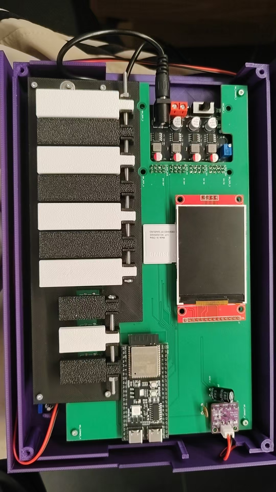

# ESP32 迷你电子琴

这是基于 ESP32-S3 的迷你电子琴项目。第一版实物使用 7 个音级键和 3 个修饰键，配有 TFT 屏幕、扬声器和 Wi-Fi 网页，支持曲谱播放与练习。

## 文件与说明

- [12V 锂电池充电母座固定试件](充电座/充电座说明.md)：STEP、STL、插合照片和试配记录。
- [第一版打印记录对应模型](第一版/打印记录对应模型/README.md)：11 类 R7b 修正件和十键排布文件有打印记录或完成报告，实物逐件对应仍待确认。
- [第一版 PCB 文件](第一版/PCB/README.md)：订单下单原始设计文件和说明。
- [第一版 ESP32 固件](第一版/固件/README.md)：实物已烧录的 0.6.16 固件源码、接线、编译环境与验证状态。

作者反馈第一版大部件可以组装完成，此前讨论的额外小部件未用于现有实物。第二版机械轴外壳仍在研究中。
