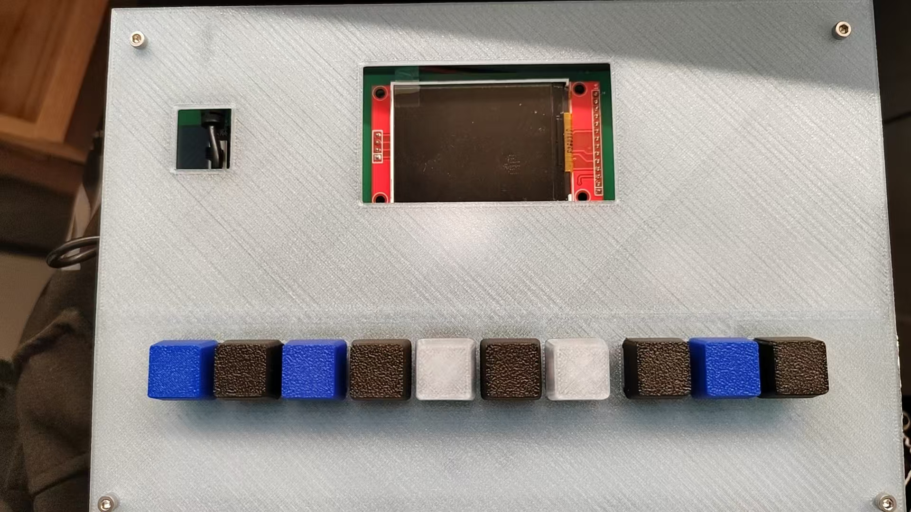
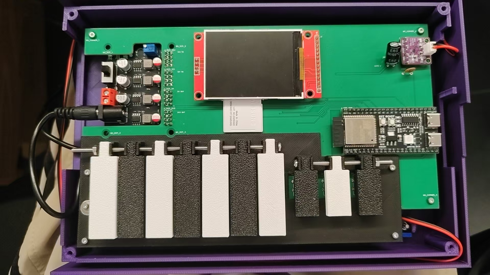

# 🎹 你好，我是一台迷你电子琴

**十个琴键，一块屏幕，和装在小小机身里的音乐。**

我从一块 ESP32-S3 和第一版电路板开始，慢慢长出了自己的外壳、机械轴琴键，还有陪伴练习的曲库。

[认识第二版](第二版/README.md) · [快速上手与设置](第二版/快速上手.md) · [制作资料](第二版/制作资料.md)

---

## 🎵 我能做什么

我的 7 个音级键和 3 个修饰键可以用来演奏；TFT 屏幕、扬声器和 Wi-Fi 网页让我能显示曲谱、播放音乐，也能陪你练习。手机与电脑端项目还可以帮助整理和传送曲谱。

## ✨ 从第一版到第二版

| | 第一版 | 第二版 |
|---|---|---|
| 我的模样 | 轻触按键与初代外壳 | 机械轴琴键与新外壳 |
| 我的身体 | ESP32-S3、PCB、屏幕和扬声器 | 复用第一版 PCB 和部分部件 |
| 当前状态 | 作者反馈大部件可以组装 | 作者报告打印键和硬件已组装完成 |
| 了解更多 | [第一版介绍](第一版/README.md) | [第二版介绍与文件](第二版/README.md) |

第二版的组装状态来自作者反馈；固件 0.6.39 的实机验收仍待完成。模型中的部分线束和电子元件为示意，不能代替实物测量。

## 🧰 想动手了解我？

- **看看我的新外壳**：[二代结构与打印文件](第二版/结构/使用说明.md)，包含 STL、3MF、STEP 和离线三维装配页面。
- **看看我的程序**：[二代固件](第二版/固件/Board2_1Piano/README.md) · [Windows 与 Android 配套源码](第二版/配套软件/README.md)。
- **了解我的第一块电路板**：[PCB 订单文件](第一版/PCB/README.md) · [物料清单](第一版/BOM.md)。
- **回顾第一版**：[固件与接线](第一版/固件/README.md) · [打印记录对应模型](第一版/打印记录对应模型/README.md)。
- **查看充电座试件**：[模型与试配记录](充电座/README.md)。

## 📷 我的第一版

谢谢你来认识我，愿每一次按键都能带来一点快乐。 🎶

