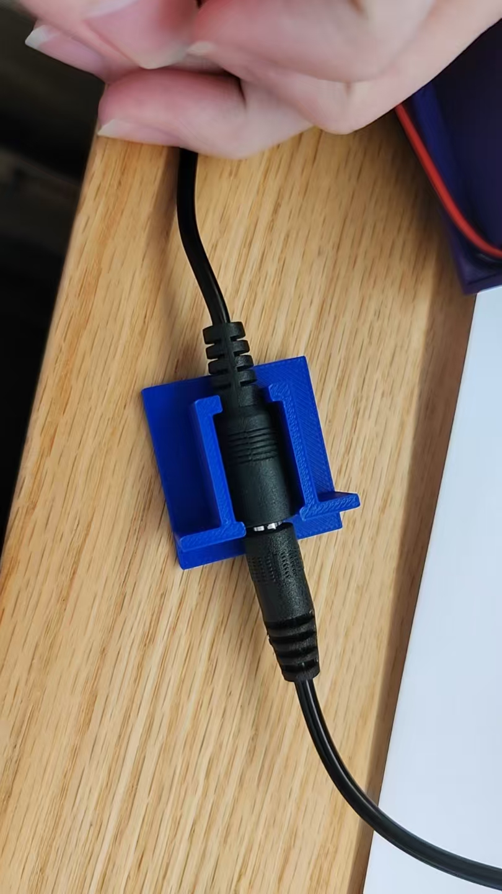

# 12V 锂电池充电母座固定试件

蓝色件是局部试配底座，用来容纳并限制充电母座移动。[STL](12v锂电池母座固定3D模型.stl) 用于切片，[STEP](12v锂电池母座固定3D模型.step) 便于查看和修改，[生成源码](充电座模型生成源码.step.py)使用 Python 与 build123d。

母座实测外径约 12 mm，硬直段约 19 mm；试件包络约 32 × 34 × 14 mm。接头形状和打印公差会影响配合，其他型号需试配。

作者实测：试件无盖插拔 10 次母座未移动，图示插合状态能正常充电。长期耐久、线根受力及整机安装仍待验证。试件不是整机底壳。
