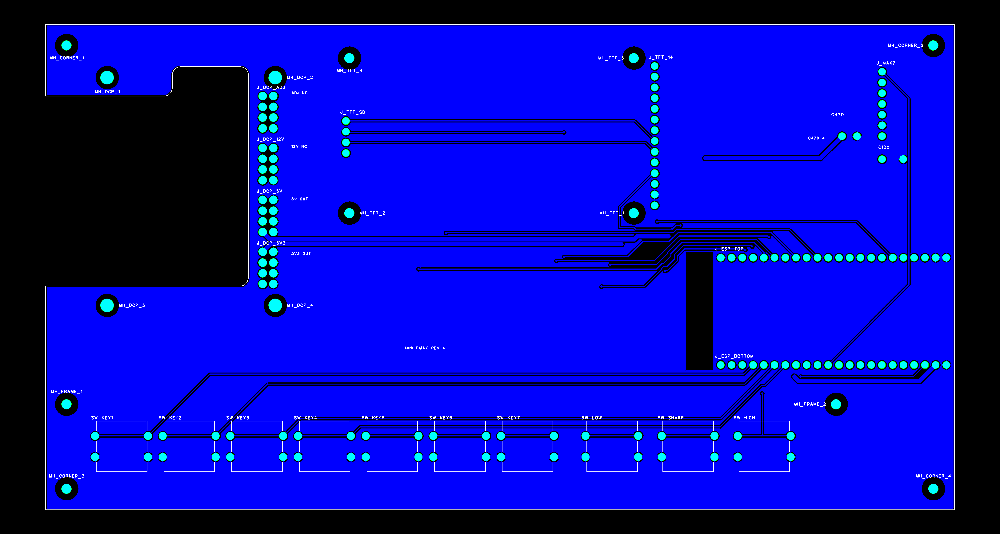
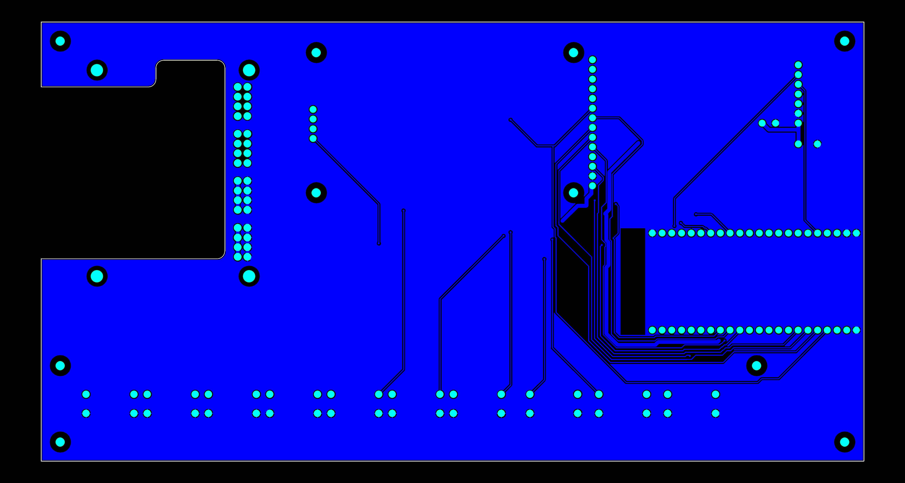

# 第一版 PCB 文件

这里保存第一版 PCB 订单中下载的**下单原始设计文件**。该订单已发货，文件名为 `电子琴_PCB2_1_20261016_144610`。下方展示为订单原文件附带的 PCB 图像；实物与本设计对应的订单由作者提供，不能以此推断每个实际尺寸和电气性能均已验证。

## 文件

[下单原文件](下单原文件/)包含原始 Gerber 层文件和钻孔文件，文件内容保持下载时原样。GTL/GBL 为顶层/底层铜，GTS/GBS 为阻焊，GTO/GBO 为丝印，GKO 为板框；另有装配层和钻孔图层。

钻孔文件中 `Drill_PTH_Through.DRL` 有 165 个电镀孔，`Drill_NPTH_Through.DRL` 有 14 个非电镀孔；`Drill_PTH_Through_Via.DRL` 的 20 个过孔已包含在前述 165 个电镀孔中。请让板厂确认如何处理这些重复的过孔记录，避免重复钻孔。

这些文件取自订单的“PCB原文件”，并非宣称与工厂最终 CAM 文件逐字节一致。订单页面显示双面板、1.6 mm 板厚、绿色阻焊和有铅喷锡；是否适用其他工艺、孔公差和接插件需另行核对。PCB 已用于第一版实物，长期可靠性和所有供电情况仍未全面验证。
