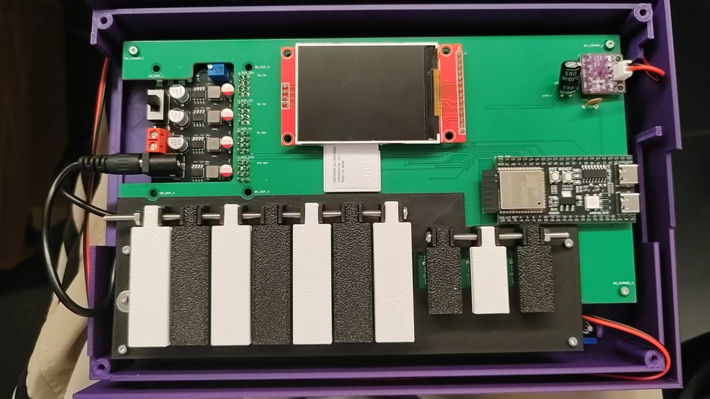

# 第一版实物资料

这是已经制作的 ESP32-S3 迷你电子琴第一版。琴键采用轻触开关，包括 7 个音级键和 3 个修饰键；配有 TFT 显示屏、功放和扬声器。

## 实物照片

第一版内部实物，可看到琴键、PCB、显示屏和 ESP32-S3 开发板。

## 文件与介绍

- [第一版物料清单（BOM）](BOM.md)：按现有实物整理主要电子件、结构件及待核实项目。

- [打印记录对应模型](打印记录对应模型/README.md)：11 类 R7b 结构件和十键排布 STL，用于查看及切片打印。
- [PCB 原始设计文件](PCB/README.md)：从已发货订单取得的下单文件，以及 PCB 正反面图像。
- [固件说明](固件/README.md)：已烧录的 0.6.16 固件源码、接线与构建说明。固件包含按键演奏、曲谱、练习模式和 Wi-Fi 网页。

## PCB 图

订单文件附带的 PCB 正面设计图，背面图和下单文件见 [PCB 原始设计文件](PCB/README.md)。

## 装配与记录

作者反馈第一版大部件可以组装完成，此前讨论的额外小部件均未用于现有实物。结构模型依据打印记录及完成报告整理；记录没有逐一确认每个现装琴键的版本。固件最新选曲与演奏模式流程仍待实机验收。
