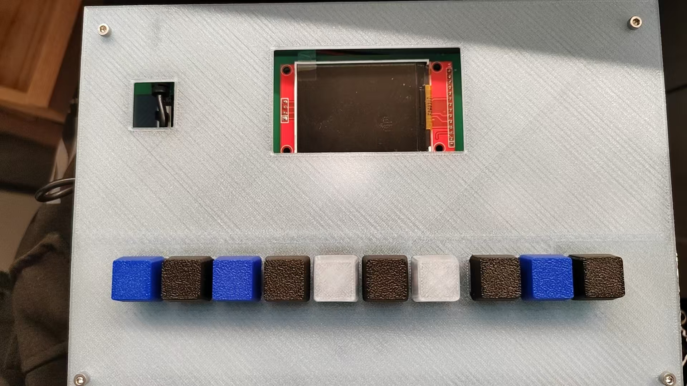

# 🎹 你好，我是迷你电子琴 2.0

**换上机械轴，住进新外壳，继续把音乐带在身边。**

我沿用了第一版的 PCB 和部分部件，也有了新的琴键与外观。

[快速试玩](https://xxy608.github.io/esp32-mini-piano/try/) · [完整模拟](https://xxy608.github.io/esp32-mini-piano/try/full/) · [快速上手与设置](快速上手.md) · [界面展示](界面展示/README.md) · [制作资料](制作资料.md) · [固件源码](固件/Board2_1Piano/README.md) · [返回首页](../README.md)

---

## 📷 看看我的模样

## 🛠️ 认识我的身体

我的上盖、底壳和键帽文件收在 [结构目录](结构/使用说明.md)，其中有 STL、3MF、STEP 和[离线三维装配展示](结构/实体琴2.0-三维装配.html)。GitHub 上的 HTML 文件需下载后在浏览器中打开，才能使用交互展示。

我复用了[第一版的 PCB 和部分部件](../第一版/README.md)。装配页面中的部分线束与电子元件是示意，具体接线和空间仍需按实物核对。

## 💻 认识我的程序

- **[琴端固件](固件/Board2_1Piano/README.md)**：当前整理的版本为 `0.6.39-board2_1`，附有宿主测试、网页代码和[构建镜像](固件/发布镜像-0.6.39/)。
- **[配套软件](配套软件/README.md)**：包含 Windows 与 Android 项目和共用解析代码。完整安装包、音色库及歌词配词运行模型未包含在仓库中。

## 📍 我现在走到哪里了

作者报告我的打印键和硬件已经组装完成。0.6.39 已通过宿主测试、网页模拟和编译检查，但尚无该版本刷入及实机验收的证据。组装完成与长期可靠性、电气和全部功能通过是不同的阶段。

固件中的自建热点密码是公开示例值，实际使用时请自行设置。
