# 迷你电子琴 2.0 界面展示

[网页试玩](https://xxy608.github.io/esp32-mini-piano/try/) · [快速上手与设置](../快速上手.md) · [返回第二版介绍](../README.md)

## 琴身屏幕

在演奏画面单独按住最右键（HIGH）约 1.2 秒，进入「首页」。从首页可选歌曲、进入演奏模式，或在「音色与音量」中调节音量。

| 首页 | 选择歌曲 | 演奏模式 |
| --- | --- | --- |
| 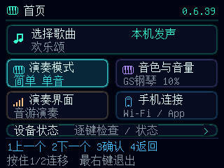 | 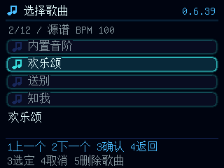 | 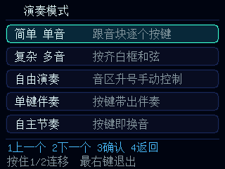 |

**音量设置**在「音色与音量 → 音量」。按 **1 / 2** 增减，按 **3** 保存，按 **4** 取消。

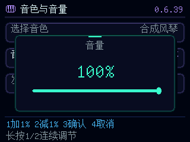

| 简单单音跟弹 | 复杂多音跟弹 | 简谱与歌词 |
| --- | --- | --- |
| 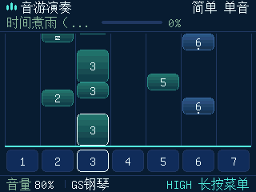 | 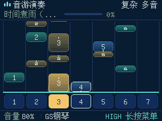 | 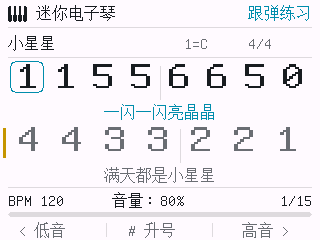 |

以上画面来自 `0.6.39-board2_1` 固件的宿主渲染，使用测试曲目和状态。实机验收待完成。

## 浏览器控制页

手机连接琴的 Wi-Fi 后，打开「手机连接」页显示的地址，即可在浏览器中调节演奏参数、控制播放和查看琴内曲库。截图使用固件自带网页和模拟设备数据。

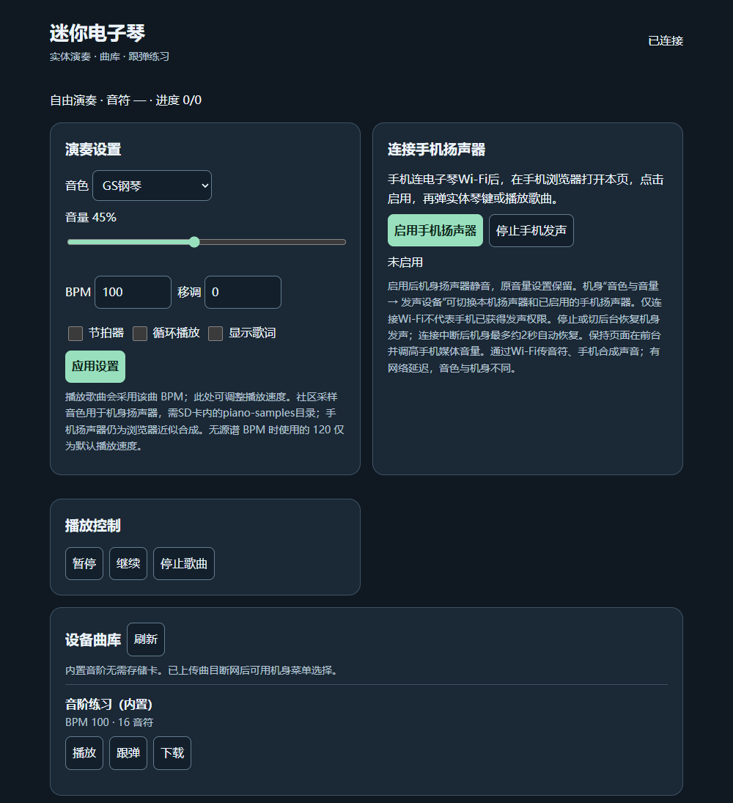

## Android App

曲库可导入或查找曲谱，从曲谱页可试听、练习或传到琴。「电子琴」页可以查看琴内曲库并调整琴端音量。

| 曲库 | 曲谱与传琴 | 电子琴 |
| --- | --- | --- |
| 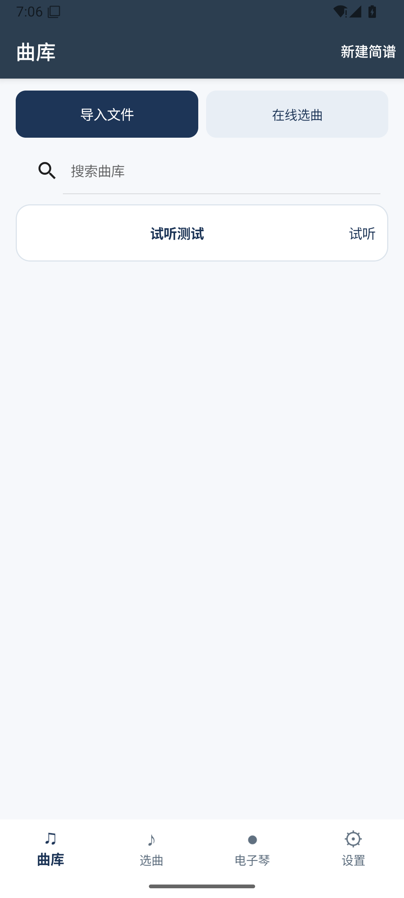 | 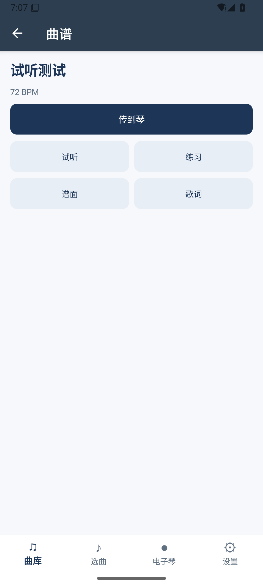 | 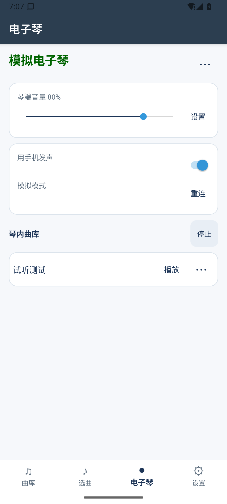 |

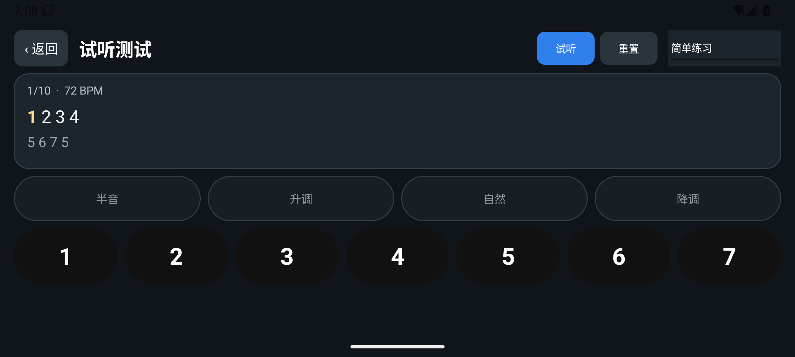

以上为 Android 0.3.12 模拟器截图。「电子琴」页使用模拟模式。

## Windows 电脑版

主窗口可导入曲谱并查看 BPM。练习窗口会标出当前音符和键盘按键提示。以下为 Windows 2.1 程序窗口，使用示例音阶。

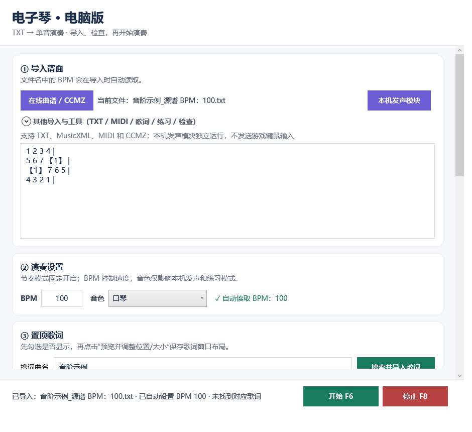

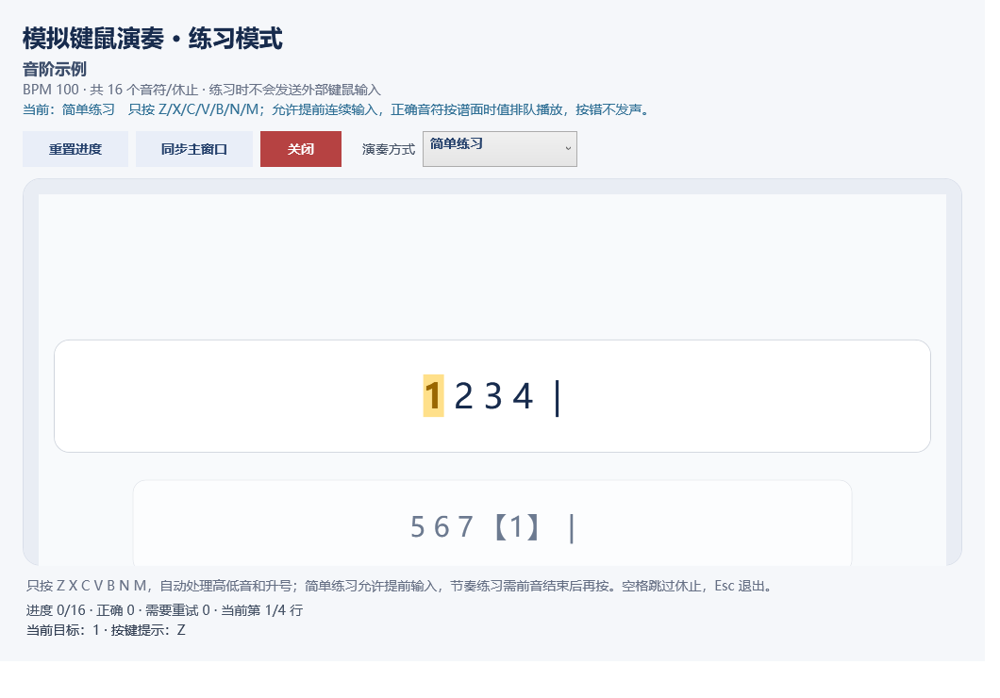
